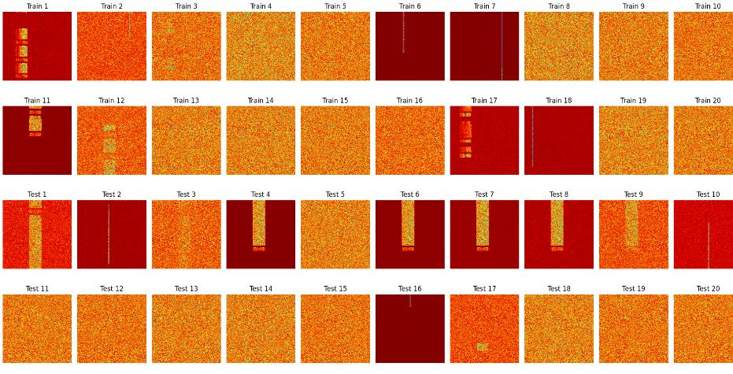
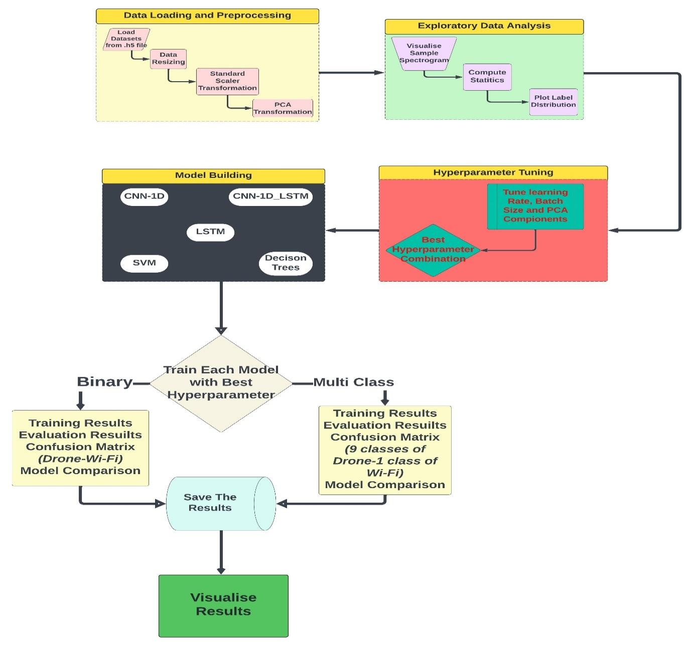
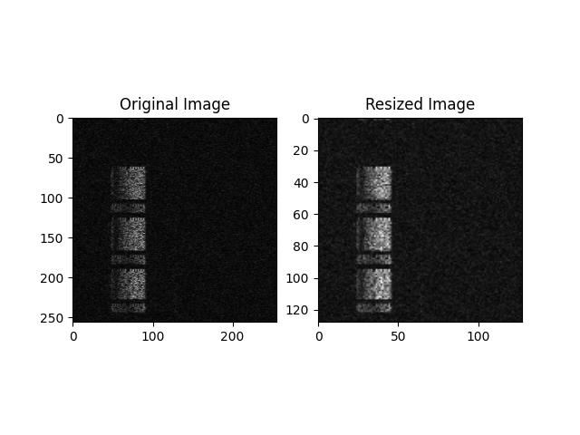
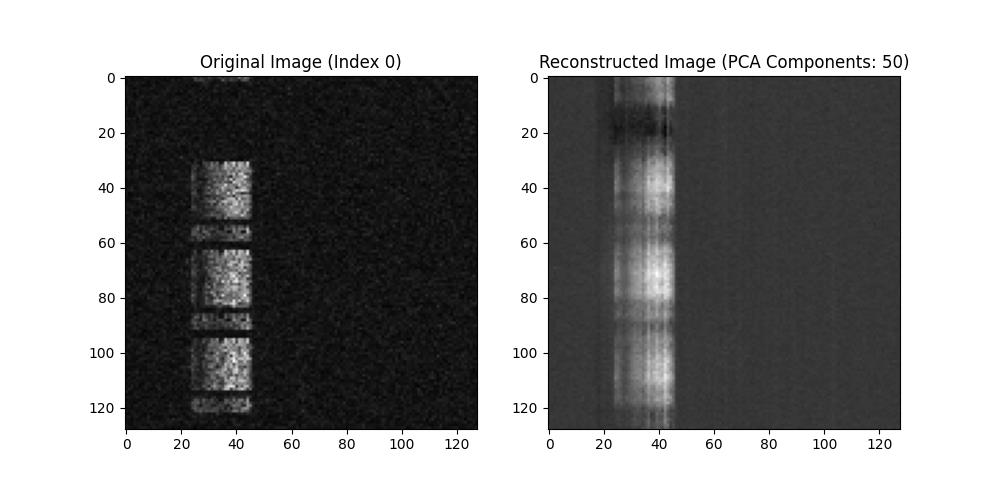
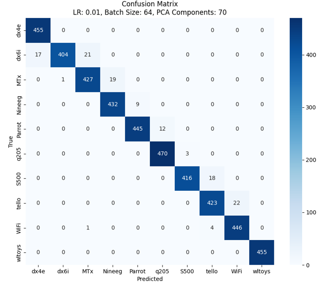
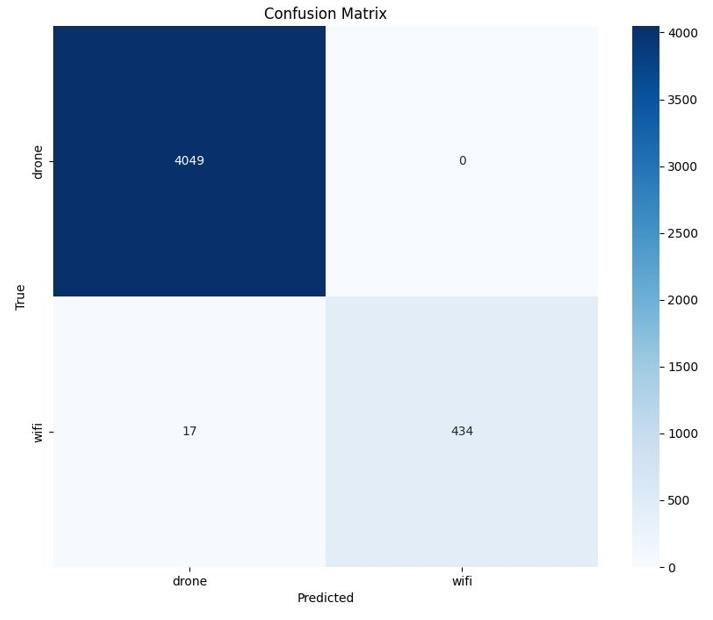
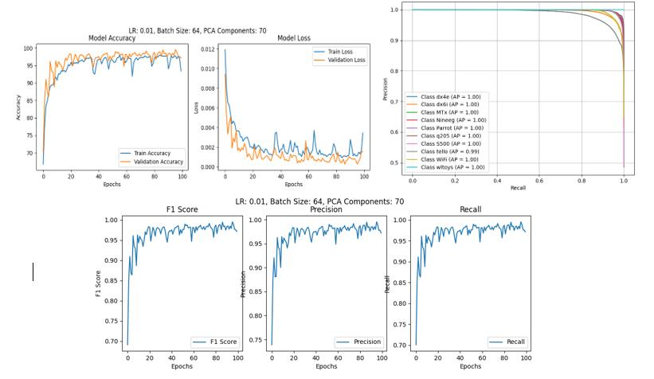

# Drone & Wi-Fi Signal Classification from RF Spectrograms

**MSc thesis project (Applied Artificial Intelligence, Cranfield University, 2024).** Classifies radio signals in the 2.4 GHz band from spectrogram images: first **drone vs Wi-Fi**, then **which of 9 drones/controllers or a Wi-Fi router** sent the signal. It compares deep learning (1D-CNN, LSTM, CNN-LSTM) with classical baselines (SVM, Decision Tree).

Python · PyTorch · scikit-learn · PCA · h5py · Matplotlib/Seaborn



---

## Why it matters

Small drones are hard to detect with radar or cameras, but they constantly talk to their controllers over radio. If a system can recognise a device from its **RF fingerprint**, it can detect unauthorised drones near airports, prisons or events, and separate them from everyday Wi-Fi traffic in the same crowded 2.4 GHz band.

## Results at a glance

| Task | Best model | Result |
|---|---|---|
| **Drone vs Wi-Fi** (binary) | LSTM | **99.6% accuracy** on 4,500 test spectrograms: every drone signal correct (4,049/4,049); Wi-Fi recall **96.2%** (434/451) with **100% precision** |
| **10-class device identification** | LSTM | **97.2%** at the final epoch (4,373/4,500, from the confusion matrix); **99.5%** at the best epoch as reported in the thesis. ⚠️ See [Limitations](#limitations-and-what-id-do-differently) |
| Deep learning vs classical ML | LSTM / CNN vs SVM, Decision Tree | Deep models ≥ 98.8% (best epoch) vs 54-58% for SVM and Decision Tree on 10 classes |
| Hyperparameter study | All deep models | 3 learning rates × 4 batch sizes × 4 PCA sizes, 100 epochs each |

## Pipeline



1. **Data:** 15,000 spectrograms (10,500 train / 4,500 test) of 9 commercial drones/controllers and 1 Wi-Fi router, recorded in an anechoic chamber with a USRP at 100 MS/s. Noise (AWGN) and multipath fading were added to simulate different signal-to-noise conditions. Source: [Basak et al.](https://github.com/sanjoy-basak/dronesignals) (see [Dataset](#dataset)).
2. **Resizing:** 256×256 → **128×128** with high-order (order-5) spline interpolation, which keeps the burst structure and cuts compute by 4×.
3. **Feature extraction:** each image is flattened, then **PCA** reduces 16,384 pixels to **50-80 components**. For the 10-class task, an additional per-sample signal feature (described in the thesis as a modulation index) is standardised and concatenated.
4. **Models:** 1D-CNN (4 conv blocks with batch norm and max pooling), LSTM (2 layers with batch norm), CNN-LSTM hybrid, SVM and Decision Tree. All deep models use Adam, cross-entropy loss, ReLU and dropout.
5. **Evaluation:** accuracy, macro precision/recall/F1, confusion matrices and precision-recall curves for both tasks.

| Resizing 256 → 128 | PCA reconstruction (50 components) |
|---|---|
|  |  |

## Results

### Model comparison (as reported in the thesis, best-epoch test accuracy)

| Model | 10-class accuracy | Binary accuracy |
|---|---|---|
| **LSTM** | **99.50%** | 99.51% |
| 1D-CNN | 99.20% | **99.78%** |
| CNN-LSTM | 98.82% | 99.47% |
| SVM | 58.00% | 64.00% |
| Decision Tree | 54.00% | 72.00% |

### Hyperparameters

- **PCA components:** 70 worked best for all three deep models; 50 and 60 lost some accuracy.
- **Learning rate:** very high rates were unstable for the 1D-CNN (around 10-15% accuracy, i.e. no learning), while the LSTM models stayed robust.
- **Best configurations:** LSTM with LR 0.01, batch 64, PCA 70 (99.55% peak); 1D-CNN with LR 0.001, batch 128, PCA 70 (99.20%).

### LSTM in detail

| 10-class confusion matrix (final epoch) | Binary confusion matrix |
|---|---|
|  |  |



### Key findings

- **Sequence models win.** Treating the PCA features as a sequence (LSTM) gave the best 10-class results; the CNN-LSTM hybrid did not beat the plain LSTM.
- **Deep learning far outperformed the classical baselines** on 10 classes. The SVM and Decision Tree were trained with default settings, so the gap is partly a tuning gap (see below).
- **Drones are easier to catch than Wi-Fi is to clear.** In the binary task every drone was detected, and all 17 errors were Wi-Fi signals labelled as drones. For a security system that is the safer kind of error (a false alarm, not a missed drone).

## Limitations and what I'd do differently

I revisited the code and results after the thesis. These points matter for reading the numbers correctly:

1. **The test set was also used for model selection.** The reported numbers are the **best epoch's test accuracy**, chosen on the same data they are measured on, which is optimistic. The final-epoch 10-class accuracy from the confusion matrix is **97.2%**. A separate validation split (or k-fold cross-validation) would give an unbiased estimate.
2. **Possible feature leakage in the 10-class experiments.** Alongside the PCA features, the 10-class experiments add `sig_origidx_F`, which looks like an identifier of the original recording (described in the thesis as a modulation index). `Main_Multi_Class.py` also adds each sample's **index** (`train_idx`/`test_idx`). If samples are stored grouped by class, such identifiers tell the model roughly which class a sample belongs to. The confusion matrix above (from the hyperparameter search, which uses `sig_origidx_F`) supports this: **every error falls on the neighbouring class in the list** (for example S500 → tello, tello → WiFi). The binary experiment uses PCA features only. The next step is to retrain the 10-class models on PCA features alone.
3. **Class imbalance in the binary task.** About 90% of test samples are drones, so a model that always answers "drone" scores 90%. Per-class recall (96.2% for Wi-Fi) is more informative than accuracy. The reported binary SVM (64%) and Decision Tree (72%) are *below* that baseline, which suggests they were not tuned and shouldn't be read as a fair comparison.
4. **Simulated conditions.** The data comes from an anechoic chamber with simulated noise and fading. Real-world validation with overlapping signals is still open.
5. **Reproducibility.** `tt.py` (standalone evaluation) refits PCA and the scalers on the test set; it should reuse the objects fitted on the training data. Data paths are hard-coded to a local Windows folder.

**Planned v2:** remove the index/identifier features, add a proper validation split, tune the classical baselines, and report mean ± std over several seeds.

## Dataset

Drone RF signals dataset by S. Basak, S. Rajendran, S. Pollin and B. Scheers: nine commercial drones/controllers (DX4e, DX6i, MTx, Nineeg, Parrot, Q205, S500, Tello, WLtoys) plus a Wi-Fi router, at 2.4 GHz. Available via [github.com/sanjoy-basak/dronesignals](https://github.com/sanjoy-basak/dronesignals).

> S. Basak, S. Rajendran, S. Pollin and B. Scheers, "Drone classification from RF fingerprints using deep residual nets," *COMSNETS 2021*, doi: 10.1109/COMSNETS51098.2021.9352891.

The data is not included in this repository.

## Project structure

| File | Purpose |
|---|---|
| `Resizing_Interpolation.py` | Resize spectrograms 256 → 128 with spline interpolation, normalise, save to HDF5 |
| `Binary_Data_Conversion.py` | Collapse the 10 classes into drone / Wi-Fi labels |
| `EDA.py` | Sample spectrograms, pixel intensity distribution, average spectrogram, label distribution |
| `Hyper_Parameter_Train.py` | Grid search over learning rate, batch size and PCA components |
| `Main_Multi_Class.py` / `Main_Binary.py` | Train the chosen deep model for the 10-class / binary task |
| `Models/Conv1d.py`, `Models/LSTM_model.py`, `Models/Conv1D_LSTM.py` | Model architectures (PyTorch) |
| `Models/SVC.py`, `Models/Decisiontree.py` | Classical baselines |
| `Best_result.py` | Pick the best run from saved training histories |
| `plot.py`, `plot_hyper.py` | Training curves, confusion matrices, precision-recall curves |
| `tt.py` | Evaluate a saved model on the test set |

## How to run

```bash
pip install -r requirements.txt
```

1. Download the dataset (see [Dataset](#dataset)).
2. Update the data paths at the top of each script; they currently point to a local Windows folder.
3. The training scripts import the models from the `Models` folder, so add it to the Python path first:
   ```powershell
   $env:PYTHONPATH = "Models"        # Windows PowerShell
   ```
   ```bash
   export PYTHONPATH=Models          # macOS / Linux
   ```
4. Run in this order:
   ```bash
   python Resizing_Interpolation.py     # 256x256 -> 128x128
   python Binary_Data_Conversion.py     # binary labels
   python EDA.py                        # optional: exploratory plots
   python Hyper_Parameter_Train.py      # optional: full grid search (GPU recommended)
   python Main_Multi_Class.py           # or Main_Binary.py
   python plot.py
   python Models/SVC.py                 # optional: classical baselines
   python Models/Decisiontree.py
   ```

Training was done on an NVIDIA A100 (Azure Lab Services). The models are small enough to train on a consumer GPU.

## Thesis

*Advanced Signal Classification of Multiple Drones and Wi-Fi Devices Using Spectrogram Analysis and Machine Learning Techniques*, MSc Applied Artificial Intelligence, Cranfield University, August 2024. Supervisor: Dr Adolfo Perrusquía; co-supervisor: Prof Weisi Guo.
